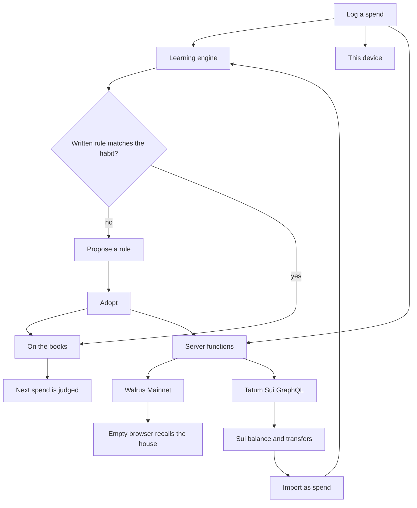

<p align="center">
  
</p>

<h1 align="center">RuleSync</h1>

<p align="center">
  Shared household spending that learns the difference between the rule you wrote and the rule you keep.
</p>

<p align="center">
  <a href="LICENSE"></a>
  <a href="https://tatum.io/hackathon/total-recall"></a>
  <a href="https://docs.wal.app"></a>
  <a href="https://sui.io"></a>
  <a href="SECURITY.md"></a>
</p>

## The problem

A household writes a rule. Groceries alone under $18. Two names over $100. Then the house spends the other way, and the budget still shows the rule they typed.

Budget apps remember the setting. They do not notice the habit. Groceries go through one person, never discussed, and land at $45. One weekday keeps repeating. A second name arrives too fast to be a real approval. Next month nobody can say which rule the house actually kept.

Shared money makes the gap worse, because the memory of it lives in one browser. A new phone starts from zero. Put the chain on the screen and people stop opening the app.

RuleSync learns the gap, asks the house to adopt it, and judges the next spend against the rule they kept. The chain stays off the screen. Walrus holds the house across sessions. Tatum reads the wallet, and a transfer can be imported into the ledger as a spend.

Built for the [Tatum × Walrus Total Recall](https://tatum.io/hackathon/total-recall) hackathon, Consumer Finance track.

## The loop



The chain is not a screen. Walrus stores the house, the spends, and the adopted rules. Tatum reads the household Sui address; any outgoing transfer can be imported as a spend, which then goes through the same engine and the same Walrus write. The balance stays labeled in SUI.

## Run

```bash
npm install
cp .env.example .env
npm run dev
```

Open the app and either start a house or load the sample house. The sample is six weeks of spends for Alex, Sam, and Max, with a written solo floor of $18. Without the env file the app still runs. Memory stays on the device, and the Mainnet controls stay hidden.

```bash
npm run typecheck
npm run build
```

## Try it

1. Open the sample house.
2. The home line states the gap. The written floor is $18. Groceries actually reach $45.
3. Adopt that rule.
4. Open Rules. It is on the books.
5. Log a grocery above the new cap. The verdict breaks.
6. Open Rules, read the Sui address with Tatum, and import an outgoing transfer. It becomes a spend, gets judged like any other, and is written to Walrus. The row then shows Imported, so the same digest cannot land twice.
7. The Memory on Walrus panel lists what Mainnet actually returns for the namespace.
8. Export writes `rulesync.json` with the house, the spends, the rules, and the memory records.

An empty house learns the same way once a pattern repeats. Nothing is pre-seeded unless you open the sample.

## What it learns

| Pattern | What has to be true |
|---|---|
| Solo cap | One category, one name, never discussed, and the top is at least 1.5× the written floor |
| Rhythm | One weekday holds at least 75% of a category, and the amounts stay tight |
| Allowance | One person makes at least 65% of a category |
| False dual | A second name arrives too fast to be a real approval |
| Never discussed | Spends under the floor that nobody talked about |

## Mainnet

The Ash House sample is stored on Walrus Mainnet.

| | |
|---|---|
| Account | `0xffc3f0363abb929a71c85181e96771cff3fac17a78936eef4ba2f17c7ce5080f` |
| Namespace | `rulesync` |
| Memories | 34 at seed: the house, 32 spends, and the adopted grocery rule. The Rules screen shows the live count for the namespace |
| Relayer | `https://relayer.memory.walrus.xyz` |
| Sui reads | `https://sui-mainnet.gateway.tatum.io/graphql` |

A server with `MEMWAL_PRIVATE_KEY` and `MEMWAL_ACCOUNT_ID` recalls that house into an empty browser. Opening a house, logging a spend, adopting a rule, importing a Tatum transfer, or pressing **Write to Mainnet** calls `remember`. The Rules screen shows the Mainnet count, the account id, and the rows Walrus returns.

If `TATUM_API_KEY` is set, Rules reads a Sui address: the SUI balance and recent outgoing transfers. JSON-RPC is no longer on that gateway, so the app uses GraphQL. A transfer can be imported as a spend; the row is keyed by digest, so re-importing is a no-op. If `SUI_ADDRESS` is set, the app reads it on open. The keys never reach the browser. Names are in [.env.example](.env.example).

## Project

```
rulesync/
├── public/
│   ├── logo.svg              Mark
│   └── favicon.svg
├── src/
│   ├── components/rulesync/
│   │   ├── app.tsx           Screens, the loop, Mainnet controls
│   │   └── marks.tsx         Logo and icons
│   ├── lib/rulesync/
│   │   ├── engine.ts         What the house repeats
│   │   ├── memory.ts         Encode, decode, restore
│   │   ├── chain.ts          Server functions the browser may call
│   │   ├── chain.server.ts   Walrus and Tatum. Keys stay here.
│   │   ├── seed.ts           Six weeks of the sample house
│   │   └── types.ts
│   ├── routes/               TanStack Start routes
│   └── styles.css
├── .env.example
├── CODE_OF_CONDUCT.md
├── LICENSE
├── SECURITY.md
└── package.json
```

The engine is in [src/lib/rulesync/engine.ts](src/lib/rulesync/engine.ts). The screen is in [src/components/rulesync/app.tsx](src/components/rulesync/app.tsx).

## Stack

TanStack Start, React 19, Tailwind CSS 4. Type is [TikTok Sans](https://fonts.google.com/specimen/TikTok+Sans).

## License and conduct

[MIT](LICENSE). [Security](SECURITY.md) covers keys and reports. [Code of conduct](CODE_OF_CONDUCT.md) covers how to work on this repo.
