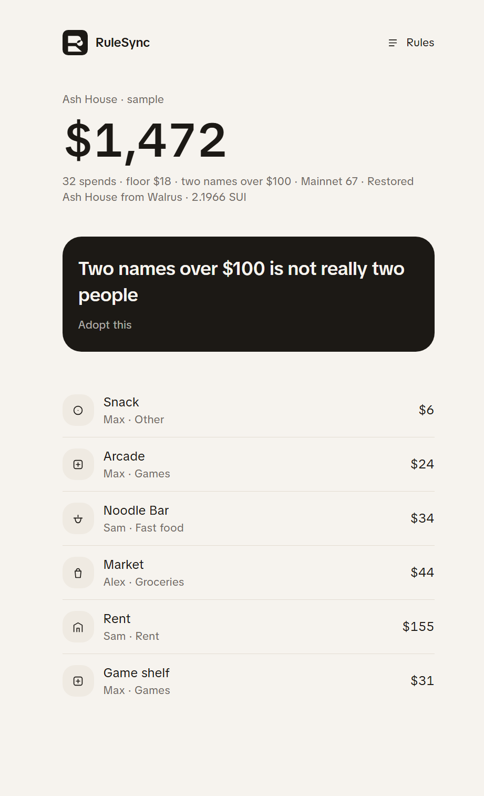
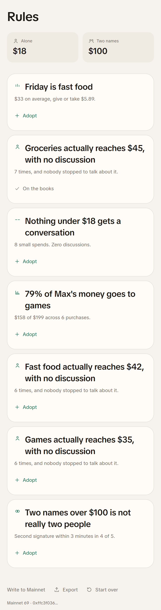
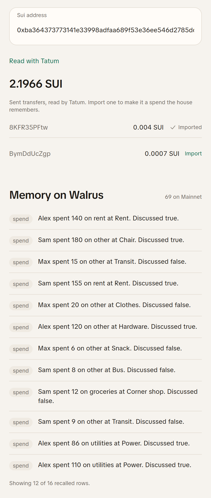

# RuleSync: Teaching Household Budgets to Remember the Rules We Actually Keep

A household writes down a rule: groceries alone, under $18. Six weeks later groceries are landing at $45, through one person, never discussed. The budget screen still says $18. Nobody lied. The rule on paper just stopped describing the house.

RuleSync is a spending app for shared money that notices that gap, asks the house to adopt the rule it actually keeps, and then judges the next spend against both.

- Live demo: https://rulesync.sithunyein.com
- Repository: https://github.com/thesithunyein/rulesync

## The loop

Written rule, observed pattern, proposed lived rule, adoption, judgment of the next spend.



Open the sample house (Alex, Sam, and Max, six weeks, 32 spends, $1,472) and the home screen states the disagreement in one line: "Two names over $100 is not really two people." Adopt it and the rule moves onto the books. Log a grocery above the adopted cap and the verdict tells you which rule just broke, the written one or the lived one.

None of this needs a wallet signature or a token. The chain stays off the screen.

## How it learns

Each pattern needs repetition before it is allowed to speak. Nothing is inferred from a single spend, and confidence is capped at `count / 4`, so a rule seen four times is as sure as a rule seen forty.

| Pattern | What has to be true |
|---|---|
| Solo cap | One category, four or more spends, one name, never discussed, top amount at least 1.5x the written floor |
| Rhythm | One weekday holds at least 75% of a category across three or more weeks, with a tight spread |
| Allowance | One person makes at least 65% of a category across four or more purchases |
| Never discussed | Four or more spends under the floor, none of them discussed |
| False dual | Four or more spends above the two-name threshold, with 75% of second signatures inside three minutes |

On the sample house that produces seven lived rules, including "Friday is fast food, $33 on average," "Groceries actually reaches $45," "79% of Max's money goes to games," and "Second signature within 3 minutes in 4 of 5."



## What gets remembered

Three kinds of records go to Walrus, each as one line of text with a JSON payload after a `||` marker:

| Kind | What it carries | Why it is stored |
|---|---|---|
| `house` | Name, members, written floor, two-name threshold | Without it there is no house to restore into |
| `spend` | Member, amount, category, merchant, date, discussed, approvals, second-sign delay | The engine needs the raw decisions, not today's conclusions |
| `adopt` | Which lived rule the house accepted, and the cap or flag it implies | Adoption is a decision, so it must survive the browser |

```ts
`RuleSync ${kind}. ${sentence} ||${JSON.stringify(payload)}`
```

The sentence is for recall and for a human reading the namespace. The payload is what rebuilds the state exactly. A line that cannot be decoded is ignored, so a malformed memory cannot corrupt the house.

Rules the house has not adopted are recomputed from the restored spends. That keeps one source of truth: decisions and adoptions are memory, everything else is derived.

The Rules screen also lists the rows Walrus actually returns in a Memory on Walrus panel, so the memory is inspectable rather than implied. A record that cannot affect the ledger, such as a spend with a non-positive amount, is ignored on restore and hidden from the panel.

## Restoring a house into an empty browser

This is the part that matters. Everything above follows the house, not the browser. A new laptop, a cleared cache, or a second phone is where a shared budget normally dies.

Writes go to Walrus Mainnet as the house changes. The sample seeds the namespace once, on the first open while it is still empty. After that, logging a spend writes that spend, adopting a rule writes the adoption, and starting a new house writes its house record. Writes are batched and carry an idempotency key so a retry does not duplicate a record.

On a cold load the app recovers the namespace before it shows anything to create, then rebuilds the household, the spends, and the adopted rules. The screen says "Waking the house from Walrus" while it works, which takes three to nine seconds on a cold browser.

`localStorage` cannot do this. It is per browser, it is a blob the app cannot query, and the second person in the household cannot see it. For shared money the memory has to live somewhere both people can reach, and it has to be readable by the app rather than by whoever remembers the password.

## Tatum: reading Sui, then importing a transfer

The Rules screen reads a Sui address through Tatum's Sui GraphQL gateway at `https://sui-mainnet.gateway.tatum.io/graphql`. JSON-RPC is no longer available on that gateway, so the app queries for the SUI balance and the last eight outgoing transactions, and turns negative balance changes into a short transfer list.

At the time of writing the demo wallet reads 2.1966 SUI with two recent transfers.

A transfer is a spend that already happened. Each row has an Import action: it opens the log sheet with the amount, digest and date prefilled, the house picks the member and the category, and saving writes a normal spend to Walrus. The spend is keyed by digest, so importing the same transfer twice is a no-op and the row switches to Imported.

That puts Tatum inside the loop instead of beside it. Read the chain, bring one transfer into the ledger, and the same engine and the same memory handle it like any spend the house logged by hand.



All of this happens in server functions. The Tatum key and the Walrus private key stay on the server; the browser only receives the balance, the transfer list, and the public account id. We checked the built client bundles for the key names before shipping.

## The bug we hit

The first restore implementation asked Walrus one question with a limit of 40:

```ts
mem.recall({ query: "RuleSync house spend adopted rule groceries", limit: 40 })
```

Against a namespace holding a house record, 32 spends, and an adopted rule, the ranking returned 39 spends and one adoption and no house. Restore requires the house record, so it failed closed and the app quietly showed an empty setup screen in a fresh browser. Everything looked fine on a machine that already had local state.

The fix was to stop trusting a single similarity query for a structured record:

```ts
const [house, broad] = await Promise.all([
  mem.recall({ query: HOUSE_QUERY, limit: 8, namespace }),
  mem.recall({ query: BROAD_QUERY, limit: 100, namespace }),
]);
if (!lines.some(isHouseMemory)) {
  const wide = await mem.recall({ query: "RuleSync house", limit: 100, namespace });
  lines = uniqueLines([...wide.results.map((h) => h.text), ...lines]);
}
```

A focused query for the record that must exist, a broad query for the history, a de-duplicating merge, and a wide fallback if the house is still missing. Restore now works in a clean browser, and the app shows a restoring state instead of the setup form so nobody can start a second house by accident.

The lesson is worth passing on: when a memory is a structured record rather than prose, query for it directly and treat similarity as a bonus, not a guarantee.

## What is on Mainnet now

| | |
|---|---|
| Account | `0xffc3f0363abb929a71c85181e96771cff3fac17a78936eef4ba2f17c7ce5080f` |
| Namespace | `rulesync` |
| Relayer | `https://relayer.memory.walrus.xyz` |
| Memory rows | 69 (36 distinct records: the house, 33 spends, the adopted grocery rule, and one superseded import row that restore ignores) |
| Sui reads | Tatum Sui GraphQL |

The extra rows are from an early seeding test that wrote the sample more than once. Rows are de-duplicated by record id on restore, so the extra copies are harmless, and the count is the live count the app shows.

## Houses, links, and closing

A new house gets a ten character id and its own namespace, `rulesync-<id>`, so two households on one Walrus account never mix rows. Rules shows an invite link with the id in the query string, and a second phone opens the same house and the same memory.

Closing a house writes one last house record with a `closedAt` mark. Restore treats that mark as final, so the invite link stops opening the house even after a cache clear. It does not erase the blobs. The relayer client has no delete call and Walrus history is append-only, so the rows already written stay, encrypted. Saying that plainly is better than shipping a delete button that lies.

## What encryption covers

Walrus Memory runs inside a TEE and uses Seal to encrypt rows before they reach Walrus. Recall decrypts them inside the relayer. The delegate key stays in the server environment and never reaches the browser, and the browser only receives the public account id. That is encryption at rest with a scoped handle, not end-to-end encryption. A server holding the delegate key can read a house while it is open, and anyone holding the invite link can open it. End to end would mean encrypting on the device under a key only the household holds, with client side embeddings, which is a different design rather than a setting.

## What is next

- A verdict that cites the exact memory row it used, not just the rule it came from.
- A weekly recap written by the house from its own rows, not typed by a person.

## Try it in a minute

1. Open https://rulesync.sithunyein.com.
2. Watch the house restore instead of starting from zero.
3. Adopt the rule the home screen proposes.
4. Log a grocery above the cap and read the verdict.
5. Open Rules to see the Mainnet count and the Sui balance from Tatum.
6. Import an outgoing transfer and watch it join the ledger as a spend.
7. Scroll to Memory on Walrus and read the rows the house actually remembers.

Built for the Tatum x Walrus Total Recall hackathon, Consumer Finance track.
